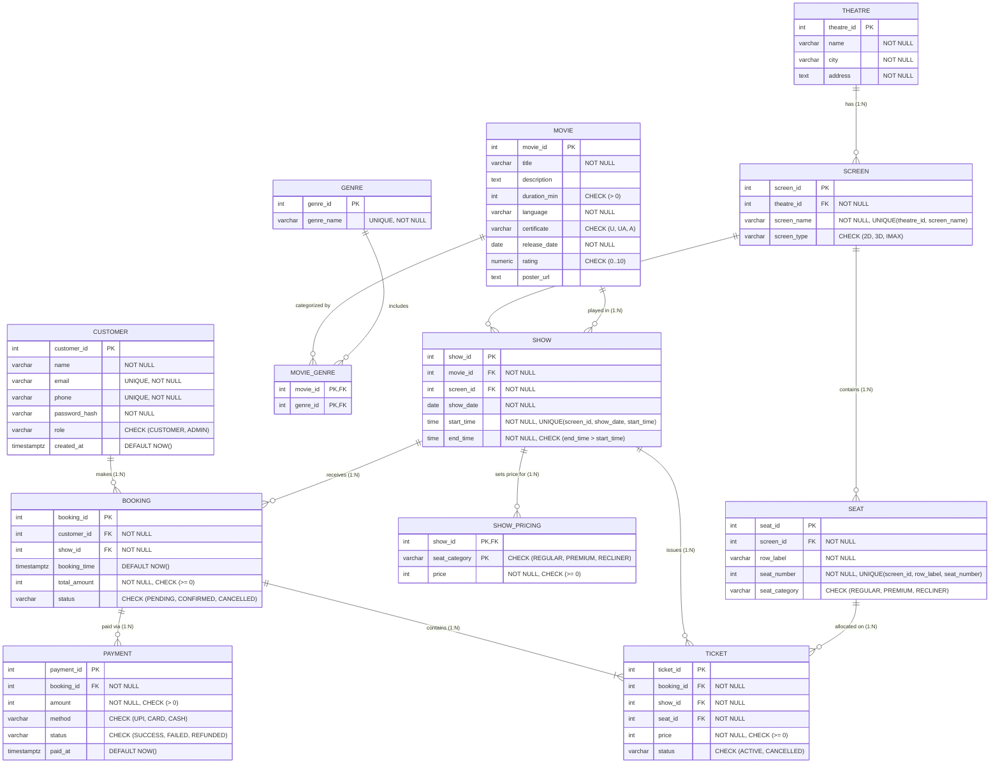

# CineBook — Database Design, ER Diagram & Relational Schema

**Project:** CineBook — Multiplex Booking System (DBMS Course Project)  
**Owner:** Yashvant A T K (ATK — Admin, Data & Documentation Lead)  
**Database Engine:** PostgreSQL 16 (Third Normal Form — 3NF)

## 1. Entity-Relationship (ER) Diagram (Mermaid)



## 2. Ready-to-Paste `dbdiagram.io` Code (DBML)

Paste the block below directly into https://www.google.com/search?q=https://dbdiagram.io/d to generate and export a high-resolution ER diagram image (`docs/er_diagram.png`) for the project repository and final report:

```dbml
Project CineBook {
  database_type: 'PostgreSQL'
  Note: 'CineBook Multiplex Booking System — 12 Tables in 3NF'
}

Table Customer {
  customer_id serial [pk]
  name varchar(100) [not null]
  email varchar(150) [unique, not null]
  phone varchar(15) [unique, not null]
  password_hash text [not null]
  role varchar(20) [not null, default: 'CUSTOMER', note: 'CHECK IN (CUSTOMER, ADMIN)']
  created_at timestamptz [not null, default: `now()`]
}

Table Movie {
  movie_id serial [pk]
  title varchar(200) [not null]
  description text
  duration_min int [not null, note: 'CHECK > 0']
  language varchar(50) [not null]
  certificate varchar(5) [not null, note: 'CHECK IN (U, UA, A)']
  release_date date [not null]
  rating numeric(3,1) [note: 'CHECK 0 TO 10']
  poster_url text
}

Table Genre {
  genre_id serial [pk]
  genre_name varchar(50) [unique, not null]
}

Table Movie_Genre {
  movie_id int [ref: > Movie.movie_id, not null]
  genre_id int [ref: > Genre.genre_id, not null]

  indexes {
    (movie_id, genre_id) [pk]
  }
}

Table Theatre {
  theatre_id serial [pk]
  name varchar(100) [not null]
  city varchar(50) [not null]
  address text [not null]
}

Table Screen {
  screen_id serial [pk]
  theatre_id int [ref: > Theatre.theatre_id, not null]
  screen_name varchar(50) [not null]
  screen_type varchar(10) [not null, note: 'CHECK IN (2D, 3D, IMAX)']

  indexes {
    (theatre_id, screen_name) [unique]
  }
}

Table Seat {
  seat_id serial [pk]
  screen_id int [ref: > Screen.screen_id, not null]
  row_label varchar(5) [not null]
  seat_number int [not null]
  seat_category varchar(20) [not null, note: 'CHECK IN (REGULAR, PREMIUM, RECLINER)']

  indexes {
    (screen_id, row_label, seat_number) [unique]
  }
}

Table Show {
  show_id serial [pk]
  movie_id int [ref: > Movie.movie_id, not null]
  screen_id int [ref: > Screen.screen_id, not null]
  show_date date [not null]
  start_time time [not null]
  end_time time [not null, note: 'CHECK end_time > start_time; trigger blocks overlap']

  indexes {
    (screen_id, show_date, start_time) [unique]
  }
}

Table Show_Pricing {
  show_id int [ref: > Show.show_id, not null]
  seat_category varchar(20) [not null, note: 'CHECK IN (REGULAR, PREMIUM, RECLINER)']
  price int [not null, note: 'CHECK >= 0']

  indexes {
    (show_id, seat_category) [pk]
  }
}

Table Booking {
  booking_id serial [pk]
  customer_id int [ref: > Customer.customer_id, not null]
  show_id int [ref: > Show.show_id, not null]
  booking_time timestamptz [not null, default: `now()`]
  total_amount int [not null, note: 'CHECK >= 0']
  status varchar(20) [not null, note: 'CHECK IN (PENDING, CONFIRMED, CANCELLED)']
}

Table Ticket {
  ticket_id serial [pk]
  booking_id int [ref: > Booking.booking_id, not null]
  show_id int [ref: > Show.show_id, not null]
  seat_id int [ref: > Seat.seat_id, not null]
  price int [not null, note: 'CHECK >= 0']
  status varchar(20) [not null, note: 'CHECK IN (ACTIVE, CANCELLED)']

  indexes {
    (show_id, seat_id) [unique, note: 'Partial UNIQUE index WHERE status = ACTIVE']
  }
}

Table Payment {
  payment_id serial [pk]
  booking_id int [ref: > Booking.booking_id, not null]
  amount int [not null, note: 'CHECK > 0']
  method varchar(20) [not null, note: 'CHECK IN (UPI, CARD, CASH)']
  status varchar(20) [not null, note: 'CHECK IN (SUCCESS, FAILED, REFUNDED)']
  paid_at timestamptz [not null, default: `now()`]
}
```

## 3. Relational Schema Table (12 Tables)

| # | Relation (Table) | Primary Key (PK) | Foreign Keys (FK) & References | Attributes & Domain Constraints |
| :--- | :--- | :--- | :--- | :--- |
| 1 | **Customer** | `customer_id` (SERIAL) | — | `name` (NOT NULL), `email` (UNIQUE, NOT NULL), `phone` (UNIQUE, NOT NULL), `password_hash` (NOT NULL), `role` (`CHECK IN ('CUSTOMER', 'ADMIN')`), `created_at` (TIMESTAMPTZ) |
| 2 | **Movie** | `movie_id` (SERIAL) | — | `title` (NOT NULL), `description`, `duration_min` (`CHECK > 0`), `language` (NOT NULL), `certificate` (`CHECK IN ('U', 'UA', 'A')`), `release_date` (DATE), `rating` (`CHECK 0..10`), `poster_url` |
| 3 | **Genre** | `genre_id` (SERIAL) | — | `genre_name` (UNIQUE, NOT NULL) |
| 4 | **Movie_Genre** | `(movie_id, genre_id)` | `movie_id` → `Movie(movie_id)` ON DELETE CASCADE<br>`genre_id` → `Genre(genre_id)` ON DELETE CASCADE | Resolves M:N relationship between `Movie` and `Genre` |
| 5 | **Theatre** | `theatre_id` (SERIAL) | — | `name` (NOT NULL), `city` (NOT NULL), `address` (NOT NULL) |
| 6 | **Screen** | `screen_id` (SERIAL) | `theatre_id` → `Theatre(theatre_id)` ON DELETE CASCADE | `screen_name` (NOT NULL), `screen_type` (`CHECK IN ('2D', '3D', 'IMAX')`), `UNIQUE(theatre_id, screen_name)` |
| 7 | **Seat** | `seat_id` (SERIAL) | `screen_id` → `Screen(screen_id)` ON DELETE CASCADE | `row_label` (NOT NULL), `seat_number` (INT, NOT NULL), `seat_category` (`CHECK IN ('REGULAR', 'PREMIUM', 'RECLINER')`), `UNIQUE(screen_id, row_label, seat_number)` |
| 8 | **Show** | `show_id` (SERIAL) | `movie_id` → `Movie(movie_id)` ON DELETE RESTRICT<br>`screen_id` → `Screen(screen_id)` ON DELETE CASCADE | `show_date` (DATE), `start_time` (TIME), `end_time` (TIME, `CHECK (end_time > start_time)`), `UNIQUE(screen_id, show_date, start_time)` + overlap-prevention trigger |
| 9 | **Show_Pricing** | `(show_id, seat_category)` | `show_id` → `Show(show_id)` ON DELETE CASCADE | `seat_category` (`CHECK IN ('REGULAR', 'PREMIUM', 'RECLINER')`), `price` (`CHECK >= 0`) |
| 10 | **Booking** | `booking_id` (SERIAL) | `customer_id` → `Customer(customer_id)`<br>`show_id` → `Show(show_id)` | `booking_time` (TIMESTAMPTZ), `total_amount` (`CHECK >= 0`), `status` (`CHECK IN ('PENDING', 'CONFIRMED', 'CANCELLED')`) |
| 11 | **Ticket** | `ticket_id` (SERIAL) | `booking_id` → `Booking(booking_id)` ON DELETE CASCADE<br>`show_id` → `Show(show_id)`<br>`seat_id` → `Seat(seat_id)` | `price` (`CHECK >= 0`), `status` (`CHECK IN ('ACTIVE', 'CANCELLED')`), **Partial Unique Index:** `CREATE UNIQUE INDEX idx_unique_active_seat ON Ticket(show_id, seat_id) WHERE status = 'ACTIVE'` |
| 12 | **Payment** | `payment_id` (SERIAL) | `booking_id` → `Booking(booking_id)` ON DELETE CASCADE | `amount` (`CHECK > 0`), `method` (`CHECK IN ('UPI', 'CARD', 'CASH')`), `status` (`CHECK IN ('SUCCESS', 'FAILED', 'REFUNDED')`), `paid_at` (TIMESTAMPTZ) |

## 4. Relationships and Cardinalities Summary

| Relationship | Cardinality | Foreign Key / Junction Implementation | Deletion Rule |
| :--- | :--- | :--- | :--- |
| **Theatre has Screens** | `1 : N` | `Screen.theatre_id` references `Theatre.theatre_id` | `ON DELETE CASCADE` |
| **Screen has Seats** | `1 : N` | `Seat.screen_id` references `Screen.screen_id` | `ON DELETE CASCADE` |
| **Screen hosts Shows** | `1 : N` | `Show.screen_id` references `Screen.screen_id` | `ON DELETE CASCADE` |
| **Movie is played in Shows** | `1 : N` | `Show.movie_id` references `Movie.movie_id` | `ON DELETE RESTRICT` (blocks deleting movies with shows) |
| **Movie has Genres** | `M : N` | `Movie_Genre(movie_id, genre_id)` junction table | `ON DELETE CASCADE` |
| **Show has Category Prices** | `1 : N` | `Show_Pricing.show_id` references `Show.show_id` | `ON DELETE CASCADE` |
| **Customer makes Bookings** | `1 : N` | `Booking.customer_id` references `Customer.customer_id` | `ON DELETE RESTRICT` |
| **Show receives Bookings** | `1 : N` | `Booking.show_id` references `Show.show_id` | `ON DELETE RESTRICT` |
| **Booking contains Tickets** | `1 : N` | `Ticket.booking_id` references `Booking.booking_id` | `ON DELETE CASCADE` |
| **Seat appears on Tickets** | `1 : N` | `Ticket.seat_id` references `Seat.seat_id` (max 1 `ACTIVE` per `show_id`) | `ON DELETE RESTRICT` |
| **Booking has Payments** | `1 : N` | `Payment.booking_id` references `Booking.booking_id` | `ON DELETE CASCADE` |

## 5. Normalization Justification (1NF, 2NF, 3NF)

1. **First Normal Form (1NF — Atomic Values & No Repeating Groups):**
   - Every attribute in all 12 tables holds a single atomic scalar value. Multi-valued genres for a movie are extracted out of comma-separated strings into the `Genre` and `Movie_Genre(movie_id, genre_id)` tables, and individual seats booked in a transaction are stored as atomic rows in `Ticket`.
2. **Second Normal Form (2NF — Full Functional Dependency on Composite Keys):**
   - In tables with composite primary keys (`Movie_Genre(movie_id, genre_id)` and `Show_Pricing(show_id, seat_category)`), every non-prime attribute depends on the **entire** composite key. Specifically, `Show_Pricing.price` depends jointly on both `show_id` (since weekend/evening shows cost more) and `seat_category` (`REGULAR`, `PREMIUM`, `RECLINER`), never on `show_id` or `seat_category` alone.
3. **Third Normal Form (3NF — No Transitive Dependencies) & Justified Historical Snapshots:**
   - Non-key attributes in `Show`, `Screen`, `Seat`, `Booking`, and `Ticket` depend solely on their table's key. Theatre city and address live only in `Theatre`; movie metadata lives only in `Movie`; customer contact details live only in `Customer`, eliminating update and deletion anomalies.
   - **Deliberate Design Exceptions (Historical Accounting Snapshots):**
     - `Ticket.price` and `Booking.total_amount` are stored at booking time so that if an admin later updates `Show_Pricing` via `PUT /shows/{id}/pricing`, historical financial receipts and refund calculations remain immutable and auditable.
     - `Ticket.show_id` is stored alongside `booking_id` and `seat_id` specifically to enable a database-level partial unique index `UNIQUE (show_id, seat_id) WHERE status = 'ACTIVE'`, making double-booking physically impossible inside PostgreSQL even under concurrent requests.
   - **Zero Stored Derivable Totals:** Screen capacity, booked seat counts, remaining seats, and occupancy percentages are never stored as table columns; they are dynamically computed via SQL views (`show_availability`, `booking_summary`, `revenue_report`).
